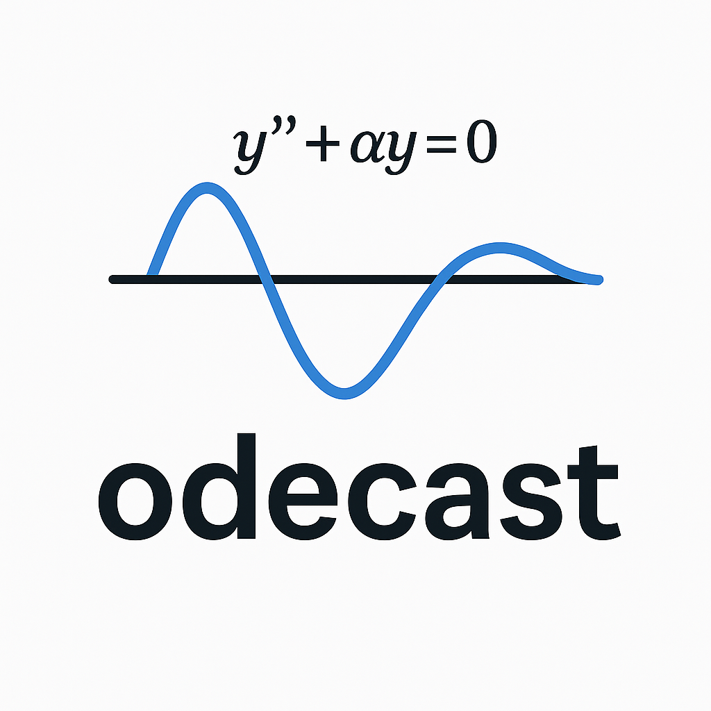

odecast
=======

odecast is a Python library for solving ordinary differential equations of
arbitrary order. Equations are written in their natural form, and odecast
performs the reduction to a first-order system that numerical integrators
require. Numerical solutions are computed with SciPy, closed-form solutions
with SymPy.

.. code-block:: python

   from odecast import var, Eq, solve

   # y'' + 0.3 y' + y = 0,  y(0) = 1,  y'(0) = 0
   y = var("y")
   eq = Eq(y.d(2) + 0.3*y.d() + y, 0)
   sol = solve(eq, ivp={y: 1.0, y.d(): 0.0}, tspan=(0, 10))

   sol.t        # time points
   sol[y]       # y(t)
   sol[y.d()]   # y'(t)

Main features:

* the order of each variable is inferred from the equations;
* coupled systems of mixed order;
* nonlinear terms such as ``y**2`` or ``sp.sin(y)``;
* vector- and matrix-valued variables and matrix products;
* parameters, with compiled systems reused across parameter values;
* initial value problems with events and resets, and boundary value
  problems with unknown parameters;
* differential-algebraic equations, including index reduction;
* validation of initial and boundary conditions before solving;
* numerical (SciPy) and symbolic (SymPy) backends;
* sensitivities with respect to parameters;
* equilibria, linearization, phase portraits, bifurcations, periodic
  orbits, and fitting parameters to data;
* delay and stochastic differential equations;
* partial differential equations with the method of lines.

.. toctree::
   :maxdepth: 2
   :caption: Contents

   installation
   quickstart
   user_guide
   analysis
   delay_stochastic
   pde
   examples
   api_reference
   contributing

Indices and tables
------------------

* :ref:`genindex`
* :ref:`modindex`
* :ref:`search`
